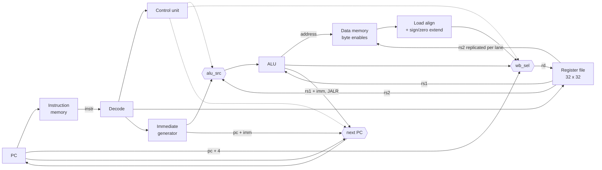

# RISC-V CPU

Single-cycle RV32I processor written from scratch in SystemVerilog. Simulation only (Vivado XSim).

Every module was built and verified on its own with a self-checking testbench before being wired into the CPU, and the CPU itself is verified by running real RV32I programs and checking register and memory state.

## Datapath



## Status

### Instructions

| Group | Instructions | Status |
|---|---|---|
| R-type | ADD, SUB, AND, OR, XOR, SLL, SRL, SRA, SLT, SLTU | ✅ runs on the CPU |
| I-type ALU | ADDI, ANDI, ORI, XORI, SLLI, SRLI, SRAI, SLTI, SLTIU | ✅ runs on the CPU |
| Loads | LB, LH, LW, LBU, LHU | ✅ verified (`tb_cpu_ldst`) |
| Stores | SB, SH, SW (byte enables + lane replication) | ✅ verified (`tb_cpu_ldst`) |
| Jumps | JAL, JALR | 🔧 next-PC logic in place, testbench pending |
| Branches | BEQ, BNE | 🔧 next-PC logic in place, testbench pending |
| Branches | BLT, BGE, BLTU, BGEU | ⏳ |
| Upper immediate | LUI, AUIPC | ⏳ |

### Verified building blocks

Each block has a self-checking testbench (random + corner cases, independent reference model):

| Module | Description | Tests |
|---|---|---|
| `alu` | 10 operations + `zero` flag | 5,490 |
| `regfile` | 32 x 32-bit, 2 read / 1 write ports, `x0` hardwired to 0 | 534 |
| `pc` | Program counter, synchronous reset | 13 |
| `imem` | Instruction memory (ROM), loaded from a hex file | 5 |
| `dmem` | Data memory, byte-enable writes, little-endian | 505 |
| `immgen` | Immediate generator for I/S/B/U/J formats | 1,200 |
| `control` | Main decoder: ALU op, operand/write-back select, memory and PC control | 11 |

CPU-level tests run a program and check the final register file and data memory:

| Testbench | Program | What it checks |
|---|---|---|
| `tb_cpu` | `test_ri.hex` | R/I arithmetic end to end (8) |
| `tb_cpu_mem` | `test_mem.s` | LW / SW (4) |
| `tb_cpu_ldst` | `test_ldst.s` | every load/store width, sign/zero extension, partial-word writes (7) |

## Tools

- **`rvasm.py`**: a small RV32I assembler written for this project. Supports all base instructions, labels, ABI register names and common pseudo-instructions (`li`, `mv`, `j`, `ret`, `beqz`, ...). Output is a commented hex file ready for `$readmemh`.

  ```
  python rvasm.py programs/test_ldst.s        # writes programs/test_ldst.hex
  python rvasm.py -e "SW x5, 4(x6)"           # encode a single line
  ```

- **`sim.bat`**: compiles all packages and modules, then elaborates and runs one testbench in XSim.

## Layout

```
rtl/        design (rtl/pkg/ compiled first)
tb/         testbenches (tb_<name>.sv)
programs/   assembly sources (.s) and hex programs
rvasm.py    assembler
```

## Run

```
.\sim <name>      # runs tb\tb_<name>.sv, e.g. .\sim cpu_ldst
```

## Roadmap

1. Complete single-cycle core: all branches, LUI, AUIPC
2. 5-stage pipeline: forwarding, load-use stall, flush
3. Verification against `riscv-tests` and a reference model
4. C toolchain: run a compiled Hello World over a UART peripheral
